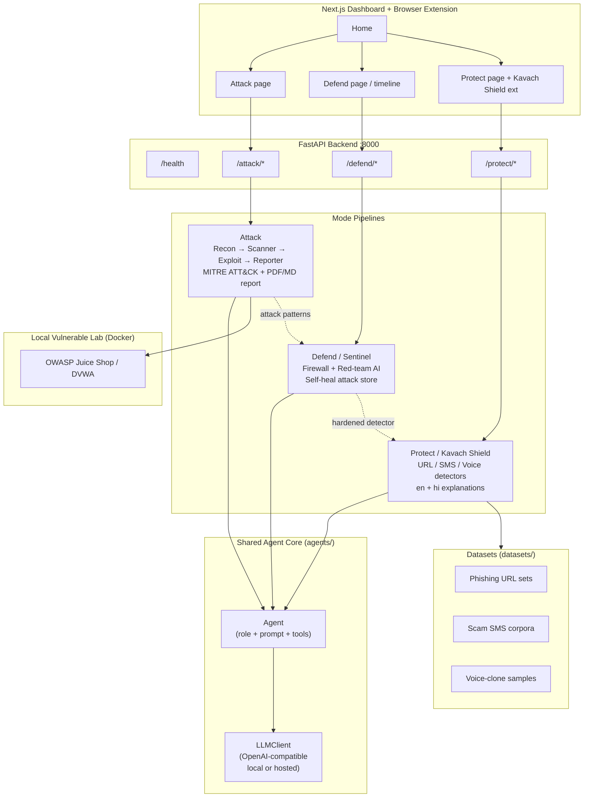

# Architecture — Kavach AI Platform

## Overview

One shared AI agent core drives three modes behind a single FastAPI backend and
one Next.js dashboard. Modes can feed each other: Attack generates attack
patterns that harden Defend; Defend's detector powers Protect.

## Mermaid diagram

## Request flow (example)

1. User opens **Attack** in the dashboard and submits a lab URL.
2. `POST /attack/scan` kicks off the multi-agent pipeline.
3. Agents call the shared `LLMClient` (local Ollama by default).
4. Findings are mapped to MITRE ATT&CK and written as Markdown + PDF.
5. Patterns that succeeded against Defend's red-team loop can be exported into
   the Protect detectors' feature store (future work / self-heal).

## Safety constraints (college project)

- Attack mode is **authorized local-lab only** (Juice Shop / DVWA in Docker).
- No real-world pentesting of third-party systems.
- Protect mode uses public datasets and uploaded samples — no live phone
  interception in v1.
